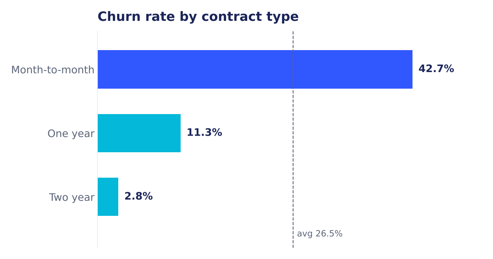
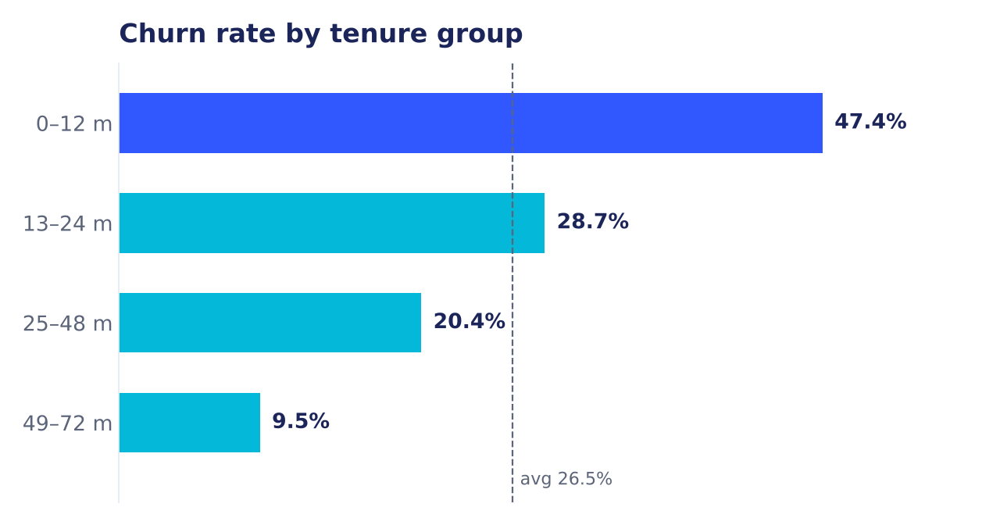
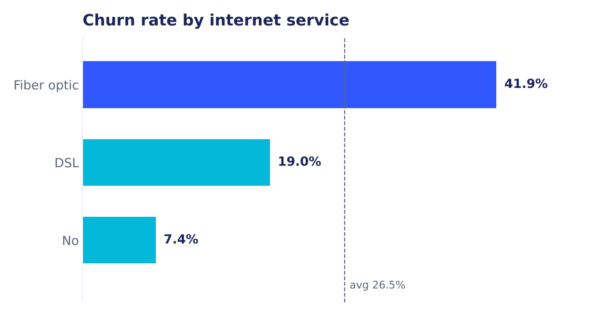
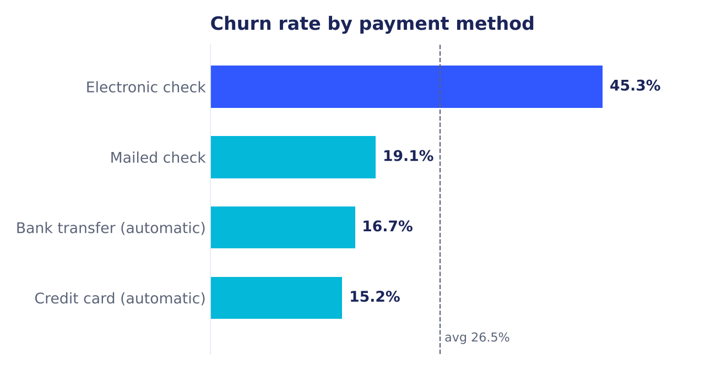
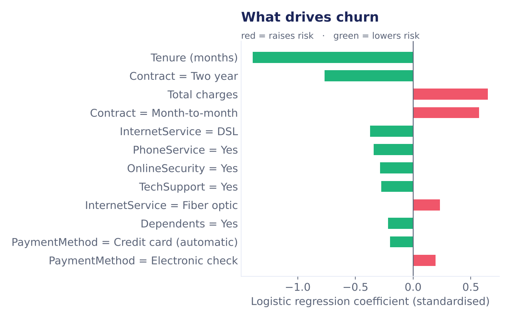
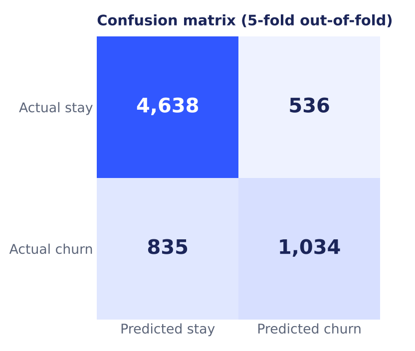

# Customer Churn Analysis & Prediction — Power BI


An end-to-end Power BI project for a telecom company: connect the customer data, clean it in Power Query, explore **why customers leave**, and **predict who is likely to leave next** so the retention team knows whom to call first.

> Built for the **SaiKet Systems Power BI Internship** (Offer Ref: SKS/A2/C166315, Sep–Oct 2026) by **Junaideen Risny Suha**.
> 🎥 Walkthrough video on LinkedIn: <https://lnkd.in/p/gcgruMFb>

---

## 📌 At a glance

| Customers | Churned | Churn rate | Model ROC AUC | Model accuracy |
|:---:|:---:|:---:|:---:|:---:|
| **7,043** | **1,869** | **26.54%** | **0.845** | **80.5%** |

---

## 🗂️ What's inside

These are the exact files submitted to the SaiKet Systems mentor on 23 Oct 2026.

```
SaiKet_PowerBI_Customer_Churn_Analysis/
├── Task1_Data_Connection.pbix        Level 1 · data connection
├── Task2_Data_Transformation.pbix    Level 2 · Power Query cleaning
├── Task3_Dashboard.pbix              Level 3 · 5-page dashboard + prediction page
├── Telco_Customer_Churn_Dataset.csv  7,043 customers × 21 columns
├── Model_Output/
│   ├── train.py                      churn model (scikit-learn)
│   ├── requirements.txt
│   └── *.csv, Model_Metrics.json     scores, drivers, retention list, metrics
├── README.txt                        submission notes
└── docs/images/                      charts used in this README
```

---

## 🔧 Task 1 — Data connection
- Imported the Telco customer CSV into Power BI Desktop: **7,043 rows, 21 columns**.
- Checked column types and previewed the data before any change.

## 🧹 Task 2 — Data transformation (Power Query)
| Step | What was done |
|---|---|
| Clean text | Trimmed spaces in all text columns |
| Duplicates | Checked `customerID` — **0 duplicates** |
| Missing values | **11 blank `TotalCharges`** (all brand-new customers with tenure 0) set to 0 |
| Data types | Whole numbers, decimals and text set correctly |
| New columns | `Churn Flag` (1/0), `Tenure Group` (0–12, 13–24, 25–48, 49–72 months) |
| Labels | `SeniorCitizen` 0/1 turned into readable Yes/No |

## 📊 Task 3 — Dashboard (5 pages)
| # | Page | What it answers |
|---|---|---|
| 1 | **Churn Rate Overview** | How many customers left, and what is the overall churn rate? |
| 2 | **Customer Demographics** | Do gender, age, partner or dependents change churn? |
| 3 | **Customer Tenure Analysis** | How does churn change the longer a customer stays? |
| 4 | **Churn Analysis** | Which contract, payment method and internet service churn the most? (stacked bars + heatmap) |
| 5 | **Churn Prediction** | Who is at high risk now, what drives the risk, and whom should we call first? |

Slicers for **Contract, Internet service, Payment method and Tenure** let the viewer filter the visuals. Colours follow the SaiKet Systems brand (blue `#3157ff`, cyan `#03b8d9`) on a light background.

---

## 💡 Key insights

<p align="center">
  
  
</p>
<p align="center">
  
  
</p>

1. **Contract is the biggest signal.** Month-to-month customers churn at **42.7%**, against **11.3%** for one-year and only **2.8%** for two-year contracts.
2. **The first year is the danger zone.** Customers in their first 12 months churn at **47.4%**; after four years it falls to **9.5%**.
3. **Fiber optic customers leave more** (**41.9%**) than DSL (**19.0%**) — a sign that price or service quality on fiber needs attention.
4. **Electronic check payers churn the most** (**45.3%**). Customers on automatic payments churn at only **15–17%**.

---

## 🤖 Churn prediction model

A **logistic regression** model (scikit-learn) scores every customer.
It uses **5-fold stratified cross-validation**, so each customer's score comes from a model that never saw that customer — the scores are honest, not memorised.

| Metric | Value |
|---|---|
| ROC AUC | **0.845** |
| Accuracy | **80.5%** (vs 73.5% if you always guess "stays") |
| Precision | 65.9% |
| Recall | 55.3% |
| F1 | 0.601 |

<p align="center">
  
  
</p>

**Risk levels:** Low (< 20%) · Medium (20–50%) · High (≥ 50%) → **1,570 customers are High risk**.
**Retention priority list:** active customers that the model rates High risk, sorted by probability — the first people the retention team should contact.

### Run the model yourself
```bash
pip install -r Model_Output/requirements.txt
python Model_Output/train.py Telco_Customer_Churn_Dataset.csv Model_Output
```
The script prints the metrics above and rewrites the four files in `Model_Output/` that feed the **Churn Prediction** page.

---

## ▶️ Open the dashboard
1. Install **Power BI Desktop** (free, Windows).
2. Open `Task3_Dashboard.pbix` — the data is already imported, so it opens without a refresh.
3. To refresh, go to **Transform data → Data source settings** and point the sources to the CSV and `Model_Output/` on your machine.

---

## 🧰 Tools
Power BI Desktop · Power Query (M) · DAX · Python · pandas · scikit-learn · matplotlib

## 👩‍💻 Author
**Junaideen Risny Suha** — Higher Diploma in IT, ICST, Sri Lanka
[LinkedIn](https://linkedin.com/in/risny-suha-8a6b66423) · [GitHub](https://github.com/DevRisny)

<sub>Dataset: Telco Customer Churn, provided by SaiKet Systems for this internship task.</sub>
